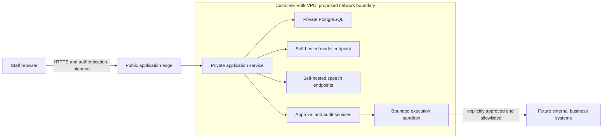

> **Superseded on 2026-11-03 (UTC).** Historical pre-event draft kept for provenance. The current plan is [02-architecture.md](roadmap/02-architecture.md). Do not implement from this file.

# Proposed architecture — not deployed or implemented

The customer owns the Vultr account and deployment. The hackathon account is separate; this task does not access either. Prefer one deployment per customer initially to reduce tenant-sharing complexity. Business identifiers remain in data contracts for defense in depth, not as proof of tenant isolation.

All boxes other than the current local static UI are plans. No network topology, API service, model endpoint, or executor has been created.

## Privacy and network design

Use a customer-owned private PostgreSQL service on VPC-only compute as the initial strict-private design; configure private-interface binding, host firewall and authenticated encrypted connections. Vultr documents VPC-only instances and NAT gateways [V1 in SOURCES]. The architecture does not assume AWS security groups, IAM semantics, private endpoints, or route-table parity. NAT is outbound connectivity, not an application-level egress policy. Permit maintenance traffic deliberately and restrict runtime egress separately.

Managed PostgreSQL is an alternative with documented VPC attachment [V2]. A private hostname alone does not demonstrate that public access is disabled: public hostname and trusted-source behavior require separate verification [V3]. Confirm the actual public-path denial with external tests before using sensitive data. No managed service capability is assumed from AWS behavior.

VPC is network isolation, not dedicated physical hardware, end-to-end encryption, protection from all operator access, or comprehensive privacy. Shared compute versus dedicated hardware must be selected and verified independently. TLS, application identity, minimum permissions, backups, restoration, retention, deletion, access logging, host hardening and dependency maintenance remain required. No compliance certification is asserted.

Keep prompts, transcripts, embeddings and inference within the customer deployment in strict-private mode. No automatic fallback to an external model or voice vendor. Redact payloads from operational logs; minimize sensitive data retained in audit records. Encrypt backups, restrict access, define retention with the customer, and test restoration. These are requirements, not existing controls.

## Browser voice, planned only

Browser microphone permission and explicit recording state precede capture. Send audio over an authenticated encrypted path to self-hosted speech-to-text inside the deployment; route text to the application and self-hosted model; return self-hosted text-to-speech audio. Avoid browser SpeechRecognition or vendor-backed speech APIs because processing location may be external. Browser audio necessarily originates on the user's device and transits the network: 'inside deployment' describes server-side processing and storage, not literal absence of transit. Disable audio persistence by default; make retention and deletion explicit. No microphone, codec, STT/TTS package, audio capture or playback is implemented here. Speech runtime, model licenses and resource needs remain unverified.

## Planned approved actions

Treat model output and retrieved content as untrusted proposals. The server should validate permissions, structured input, business scope, target version, exact diff, expiry and idempotency before requesting approval. Bind approval to the immutable proposal and authenticated staff identity. Recheck constraints just before execution; reject stale availability or stock. Bounded executors should expose narrow allowlisted operations, with deadlines, resource limits and isolated runtime identities. Record outcomes and receipts; handle timeout uncertainty without blind retries. These mechanisms are deliberately unimplemented.

Audit design: append-only application events, restricted writer privileges, independent retention/export and integrity checks. A UI table or SQL schema is not tamper-proof logging. Real authorization, audit integrity and isolation require tests during implementation.

## Resource paths

| Path | Candidate | Limits and decision gate |
|---|---|---|
| Long-term strict-private | Customer CPU app/database and self-hosted GPU inference; self-hosted speech | GPU product documented [V4,V5]; quota, region, availability, licenses, performance and cost unverified |
| Event, Challenge 2 candidate | CPU VM backend with synthetic data; small CPU model only if feasible | Event GPUs unavailable [E1]; CPU inference is an experiment, no latency claim; speech may be deferred |
| Event optional alternative | Vultr Serverless Inference with synthetic data only | Challenge 2 permits it [E1]; processing is outside the customer self-hosted endpoint boundary and must be disclosed |
| Challenge 1 | Required serverless inference plus sandbox | Conflicts with an exclusively self-hosted inference story; confirm track before implementing |

Planning preference is Challenge 2, pending organizer clarification. No cloud commands or infrastructure-as-code are included. Before any provisioning, separately authorize budget and account use, verify quotas and current prices, benchmark model memory/latency, and select region. The current local preview works without any event infrastructure.
