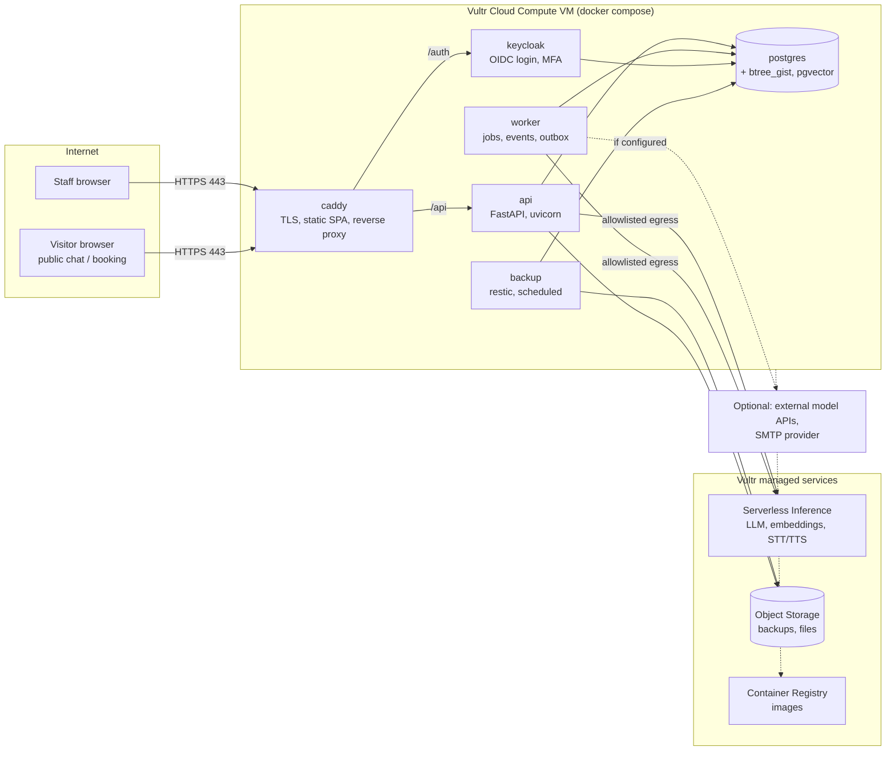
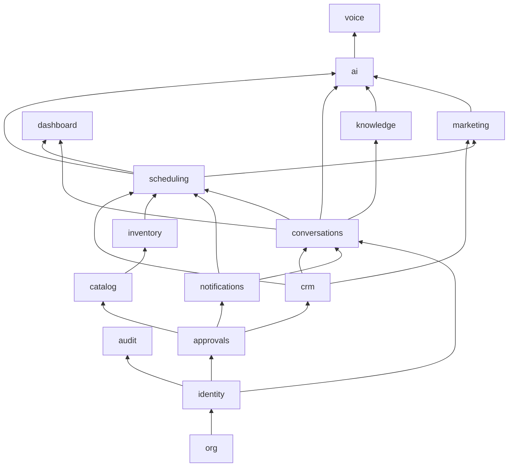
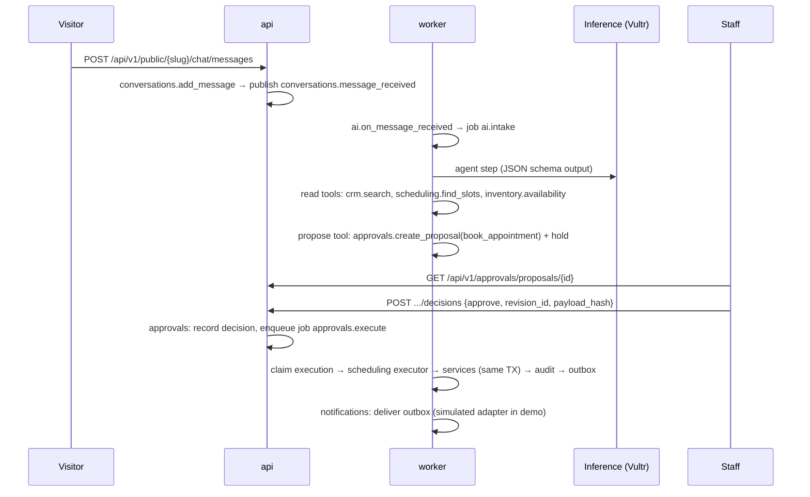

# 02 · Architecture

## Summary

- **Shape:** a *modular monolith*. One Python backend codebase is split into strictly bounded modules and runs as two processes from the same image: `api` (HTTP) and `worker` (jobs, events, outbox). A React single-page app is served by Caddy.
- **State:** one PostgreSQL database. Each module owns its tables. Row-level security isolates businesses.
- **Identity:** Keycloak handles authentication. The application handles authorisation (roles and permissions per business).
- **AI:** a provider-agnostic inference gateway inside the backend. Vultr Serverless Inference is the default provider; external low-cost models and local models are configurable alternatives ([08](08-ai-layer.md)).
- **Packaging:** Docker images plus a Compose file per deployment. Terraform with the Vultr provider plus cloud-init installs a customer's copy on their own Vultr account ([10](10-vultr-infrastructure.md)).

Why a modular monolith and not microservices: one small team, one database transaction for multi-module actions (booking plus reservation plus audit), one deployable for SMB customers and simple operations. Strict module boundaries give most of the maintainability benefit of services. A module could be split out later because it already talks to others only through its `public.py`. See [ADR-001](03-decisions.md#adr-001-modular-monolith).

## Runtime topology (one customer deployment)



Only Caddy publishes ports (80 and 443). Postgres, Keycloak, api and worker are reachable only on the internal Docker network. Keycloak's admin console is not exposed publicly ([06](06-security-and-privacy.md#network-exposure)).

## Backend module map and dependency graph

Every module may import `app.platform.*` and the `public.py` of the modules listed for it below, **and nothing else**. The graph is declared in code (`backend/app/modules/dependencies.py`) and enforced by a test ([04](04-repository-and-conventions.md#module-boundaries-are-tested)). It must stay acyclic.

| Module | May depend on (besides platform) | Layer |
|---|---|---|
| `org` | — | 1 |
| `identity` | org | 1 |
| `audit` | identity | 1 |
| `approvals` | org, identity | 1 |
| `notifications` | org, identity, approvals | 1 |
| `files` | — | 1 |
| `crm` | approvals | 2 |
| `catalog` | org, approvals | 2 |
| `inventory` | org, catalog, approvals | 3 |
| `scheduling` | org, crm, catalog, inventory, conversations, approvals, notifications | 3 |
| `conversations` | org, identity, crm, approvals, notifications | 3 |
| `knowledge` | org, conversations | 4 |
| `marketing` | org, crm, catalog, scheduling, approvals, notifications | 4 |
| `sales` (v1) | org, crm, catalog, inventory, scheduling, approvals, notifications | 4 |
| `purchasing` (v1) | org, catalog, inventory, approvals, notifications | 3 |
| `dashboard` | org, crm, scheduling, inventory, conversations, approvals, notifications | 4 |
| `ai` | org, identity, crm, catalog, scheduling, inventory, conversations, knowledge, marketing, approvals, sales, purchasing, dashboard, notifications | 4 |
| `voice` | ai, conversations | 5 |
| `admin_ops` (v1) | org, identity, files, notifications, crm | 4 |


*(Arrows point from a dependency to the module that uses it. Only the main edges are drawn; the table is authoritative.)*

**Rules for communication between modules**

1. **Call downward.** A module that needs something synchronously calls a function in a lower module's `public.py`, passing the same database session so everything happens in one transaction. Example: the scheduling executor calls `inventory.public.reserve_stock(db, ctx, ...)`.
2. **Publish upward.** A lower module never imports a higher one. When higher modules need to react, the lower module publishes a domain event ([07](07-workflow-engine.md#domain-events)). Example: `conversations` publishes `conversations.message_received` and `ai` subscribes.
3. **Shared reference data goes down, not sideways.** The customer timeline is owned by `crm`. Modules above it write entries with `crm.public.add_timeline_entry(...)`.
4. **Database foreign keys may point to another module's table** (for example `appointments.customer_id → customers`), for integrity only. Reading that table still goes through its owner's `public.py`.
5. **The composition root (`app/main.py`, `app/worker.py`) is the only place that knows all modules.** It mounts routers and registers executors, job handlers and event subscribers by calling each module's `register(registry)` function.

## Inside a module (layers)

```
api.py          HTTP only: parse request → call service → map result. No SQL, no business rules.
service.py      Business rules and transactions boundaries are *used* here (never commits itself).
repository.py   All SQL for this module. Every query is business-scoped.
models.py       SQLAlchemy table classes owned by this module.
schemas.py      Pydantic request/response models (become OpenAPI).
public.py       The only file other modules may import: functions + DTOs + event types.
permissions.py  Permission strings this module defines.
executors.py    Executors for approved action types this module owns (optional).
jobs.py         Background job handlers (optional).
events.py       Event payload types it publishes and handlers it subscribes (optional).
```

Allowed calls inside a module: `api → service → repository → models`. `public.py` re-exports selected service functions and DTOs. `executors.py` and `jobs.py` call `service.py`.

## Key flows

### A staff request (direct path)

```mermaid
sequenceDiagram
  participant B as Browser
  participant C as Caddy
  participant A as api (FastAPI)
  participant DB as Postgres
  B->>C: PATCH /api/v1/crm/customers/{id} (cookie, X-CSRF-Token, body with version)
  C->>A: forward
  A->>A: middleware: request_id, logging
  A->>A: deps: session → user → active business → permission "crm.customer.write"
  A->>DB: BEGIN; SET LOCAL app.business_id, app.user_id
  A->>DB: UPDATE customers ... WHERE id=? AND version=? (RLS applies)
  A->>DB: INSERT audit_events (same transaction)
  A->>DB: COMMIT
  A-->>B: 200 customer (version+1) | 409 version conflict | 403 | 422
```

### An AI-originated change (proposal path)



The direct path and the proposal path end in **the same service functions**. Executors are thin adapters that turn a payload into service calls.

## Cross-cutting concerns and where they live

| Concern | Lives in | Spec |
|---|---|---|
| Configuration (env vars, typed) | `app/platform/config.py` | [M00](modules/M00-platform.md) |
| Request context (user, business, permissions, request id) | `app/platform/context.py` | [M00](modules/M00-platform.md) |
| Tenancy (row-level security session variables) | `app/platform/db.py` | [05](05-data-model.md#tenancy-and-row-level-security) |
| Permission registry and checks | `app/platform/permissions.py` | [06](06-security-and-privacy.md) |
| Audit writer | `app/platform/audit.py` | [07](07-workflow-engine.md#audit) |
| Jobs and worker loop | `app/platform/jobs.py`, `app/worker.py` | [07](07-workflow-engine.md#jobs) |
| Domain events | `app/platform/events.py` | [07](07-workflow-engine.md#domain-events) |
| Outbound HTTP with egress allowlist | `app/platform/http.py` | [06](06-security-and-privacy.md#egress) |
| Errors (RFC 9457 problem details) | `app/platform/errors.py` | [04](04-repository-and-conventions.md#api-conventions) |
| Time, IDs, money | `app/platform/clock.py`, `ids.py`, `money.py` | [05](05-data-model.md) |

## Scaling path (do not build now)

1. **One VM, Compose** (MVP, most SMB customers): 2–4 vCPU, 4–8 GB.
2. **Bigger VM plus Vultr Managed PostgreSQL in a VPC** (larger customers): the database moves out and the app VM becomes stateless.
3. **Two or more app VMs behind a Vultr Load Balancer** (rare for SMBs): requires shared sessions, which already live in Postgres, and the worker on its own VM.
4. **Vultr Kubernetes Engine:** only if a hosted multi-customer offering is ever built. Not planned ([ADR-008](03-decisions.md#adr-008-docker-compose-on-a-vm-not-kubernetes)).
