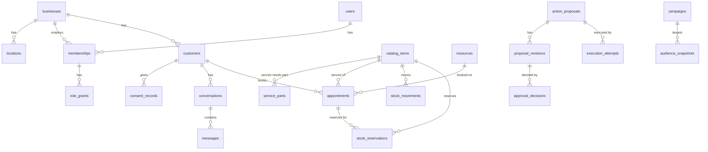

# 05 · Data model

Column-level table definitions live in each module spec under "Tables". This document defines the **rules every table follows**, tenancy, platform-owned tables and the index of which module owns which table.

## Conventions for every table

| Rule | Detail |
|---|---|
| Primary key | `id uuid` (UUIDv7 from `platform/ids.py`) |
| Tenancy column | `business_id uuid not null references businesses(id)` on every business-scoped table, plus `unique (business_id, id)` so other tables can use composite foreign keys |
| Composite foreign keys | References between business-scoped tables use `(business_id, x_id) → (business_id, id)`, so a row can never point into another business |
| Optimistic lock | `version integer not null default 1` on every mutable table |
| Timestamps | `created_at timestamptz not null default now()`, `updated_at timestamptz not null default now()` (trigger), plus event times such as `occurred_at` where needed. Always UTC |
| Actor columns | `created_by uuid null` (user id). Rows the assistant creates also store `origin_kind` (`staff`, `assistant`, `rule`, `visitor`, `system`) |
| Enumerations | `text` + `CHECK (col in (...))`. No Postgres enum types, because they are hard to migrate |
| Money | `<name>_minor bigint` + `currency char(3)` |
| Quantity | `numeric(14,3)` + `unit text` (`each`, `hour`, `kg`, `l`, `m`) |
| Soft delete | `status = 'archived'` for master data. Ledgers (stock movements, audit, decisions) are append-only and never deleted |
| JSON | `jsonb` only for payloads that are versioned as a whole (proposal payloads, event payloads, settings). Never for data that is filtered or joined on |
| Names | `snake_case`, plural table names, `<singular>_id` foreign keys |
| PII | Columns holding personal data are listed as **PII** in the module spec. They are redacted from audit diffs and logs, and covered by erasure ([06](06-security-and-privacy.md#retention-and-erasure)) |

## Tenancy and row-level security

**Database roles.** These are created by `deploy/compose/postgres-init.sql`, or by the operator on managed Postgres.

| Role | Used by | Rights |
|---|---|---|
| `smb_owner` | Alembic migrations only | Owns all tables. `BYPASSRLS` (needed for data migrations). Extensions are created by the superuser in `postgres-init.sh` |
| `smb_app` | api and worker | `SELECT, INSERT, UPDATE, DELETE` on module tables; **`INSERT, SELECT` only** on append-only tables (`audit_events`, `stock_movements`, `approval_decisions`, `proposal_revisions`). Subject to row-level security |
| `keycloak` | Keycloak | Owns the separate `keycloak` database only |

**Session variables.** `platform.db.transaction(ctx)` sets `app.business_id` and `app.user_id` with `set_config(..., true)`, which scopes them to the transaction. A connection returned to the pool therefore carries no tenant state.

**Standard policy** (created by `migrations/helpers.py::enable_business_rls`):

```sql
alter table customers enable row level security;
alter table customers force row level security;
create policy business_isolation on customers
  using      (business_id = nullif(current_setting('app.business_id', true), '')::uuid)
  with check (business_id = nullif(current_setting('app.business_id', true), '')::uuid);
```

If no business is set, the expression is `NULL` and **no rows are visible**, so the policy fails closed.

**Special cases**

| Table | Policy |
|---|---|
| `businesses` | Visible if `id = app.business_id` or the user has an active membership (`exists (select 1 from memberships …)`) |
| `memberships`, `role_grants` | Visible if `business_id = app.business_id` or `user_id = app.user_id`, so the business picker can list the user's businesses |
| `users`, `sessions`, `oidc_login_states` | Global, with no `business_id`. Accessed only through `identity` repository functions |
| Queue tables: `jobs`, `domain_events`, `event_deliveries`, `outbox_messages`, `rate_limits` | **Exempt from row-level security**, because the worker must claim work across businesses. Only platform and notifications code touches them. After claiming a row, the handler opens a new `transaction(ctx)` with that row's `business_id` |
| Public slug lookup | `security definer` function `public_business_by_slug(slug)` returns only `id, name, timezone, public_settings` |

The exemption list is a constant in `tests/architecture/test_rls.py`, so adding a table to it is a visible decision.

## Platform-owned tables (M00)

```sql
-- Generic background jobs
create table jobs (
  id uuid primary key,
  business_id uuid null references businesses(id),
  kind text not null,                       -- 'approvals.execute', 'ai.intake', ...
  payload jsonb not null,
  status text not null default 'queued' check (status in ('queued','running','succeeded','failed','dead')),
  priority smallint not null default 100,   -- lower runs first
  run_at timestamptz not null default now(),
  attempts int not null default 0,
  max_attempts int not null default 8,
  locked_by text null,
  locked_until timestamptz null,
  dedupe_key text null unique,
  last_error text null,
  created_at timestamptz not null default now(),
  updated_at timestamptz not null default now()
);
create index jobs_ready on jobs (priority, run_at) where status = 'queued';

-- Domain events and per-subscriber delivery (at-least-once)
create table domain_events (
  id uuid primary key,
  business_id uuid not null references businesses(id),
  type text not null,                       -- 'conversations.message_received'
  schema_version smallint not null default 1,
  payload jsonb not null,
  actor_kind text not null,
  actor_id uuid null,
  request_id text null,
  occurred_at timestamptz not null default now()
);
create table event_deliveries (
  event_id uuid not null references domain_events(id),
  subscriber text not null,                 -- 'ai.on_message_received'
  status text not null default 'pending' check (status in ('pending','running','done','dead')),
  attempts int not null default 0,
  run_at timestamptz not null default now(),   -- backoff for retries
  locked_until timestamptz null,               -- reaper requeues stale 'running' rows
  last_error text null,
  done_at timestamptz null,
  primary key (event_id, subscriber)
);

-- Append-only audit log
create table audit_events (
  id uuid primary key,
  business_id uuid not null references businesses(id),
  occurred_at timestamptz not null default now(),
  actor_kind text not null check (actor_kind in ('user','assistant','system','visitor')),
  actor_id uuid null,
  on_behalf_of_user_id uuid null,           -- assistant acting for a user
  action text not null,                     -- 'crm.customer.updated'
  target_type text not null,
  target_id uuid null,
  proposal_id uuid null,
  ai_run_id uuid null,
  request_id text null,
  summary text not null,                    -- human-readable, no PII beyond names
  changes jsonb not null default '{}'       -- redacted diff
);

-- API idempotency
create table idempotency_keys (
  business_id uuid not null references businesses(id),
  key text not null,
  user_id uuid null,
  request_hash text not null,
  response_status int not null,
  response_body jsonb not null,
  created_at timestamptz not null default now(),
  primary key (business_id, key)
);

-- Fixed-window rate limiting for public and login endpoints
create table rate_limits (
  key text not null, window_start timestamptz not null, count int not null,
  primary key (key, window_start)
);
```

## Core entity overview



## Table ownership index

| Module | Tables |
|---|---|
| M00 platform | `jobs`, `domain_events`, `event_deliveries`, `audit_events`, `idempotency_keys`, `rate_limits` |
| M01 identity | `users`, `sessions`, `memberships`, `role_grants`, `invitations`, `oidc_login_states` |
| M02 org | `businesses`, `locations`, `opening_hours`, `business_settings` |
| M03 crm | `customers`, `contact_points`, `consent_records`, `customer_notes`, `tags`, `customer_tags`, `timeline_entries` |
| M04 conversations | `conversations`, `messages`, `visitor_tokens` |
| M05 catalog | `catalog_items`, `service_parts` |
| M06 scheduling | `resources`, `resource_services`, `availability_rules`, `availability_exceptions`, `appointments` |
| M07 inventory | `stock_locations`, `stock_levels`, `stock_movements`, `stock_reservations`, `reorder_rules`, `reorder_drafts`, `reorder_draft_lines` |
| M08 approvals | `action_proposals`, `proposal_revisions`, `approval_decisions`, `execution_attempts` |
| M09 audit | — (reads `audit_events`) |
| M10 notifications | `outbox_messages`, `delivery_attempts`, `in_app_notifications` (`message_templates` in v1) |
| M11 dashboard | — (read-only aggregation) |
| M12 marketing | `segments`, `campaigns`, `campaign_revisions`, `audience_snapshots`, `audience_members`, `suppressions` |
| M13 ai | `ai_runs`, `ai_run_steps`, `assistant_threads`, `assistant_messages`, `ai_usage_daily`, `knowledge_documents`, `knowledge_chunks` (stretch) |
| M14 voice | `voice_sessions` (metadata only, no audio) |
| M15 files | `files` |
| M16 sales | `document_sequences`, `quotes`, `quote_lines`, `sales_orders`, `sales_order_lines`, `invoices`, `invoice_lines` |
| M17 purchasing | `suppliers`, `supplier_items`, `purchase_orders`, `purchase_order_lines`, `goods_receipts`, `goods_receipt_lines`, `purchase_order_sequences` |
| M18 admin_ops | `erasure_requests`, `export_jobs`, `system_checks` |

## Seed and demo data

`data/fixtures.json` is the synthetic dataset (two businesses, staff with every role, customers with mixed consent, services, parts, resources, appointments including a deliberate conflict, stock below reorder level, a pending proposal). Task P3-14 writes `python -m app.cli seed`. It loads the dataset **through module services**, so seeding exercises the same rules as the app. Fixture IDs are stable strings and are mapped to UUIDv7 at seed time through a deterministic `uuid5` namespace, so tests can refer to `cust-ada` and similar keys.

`data/schema.sql` is a portable data contract that validates the fixtures in SQLite. It is **not** the production schema. Alembic migrations are authoritative from P1 onward, and the SQLite contract must be kept consistent with them only for the tables it covers.
