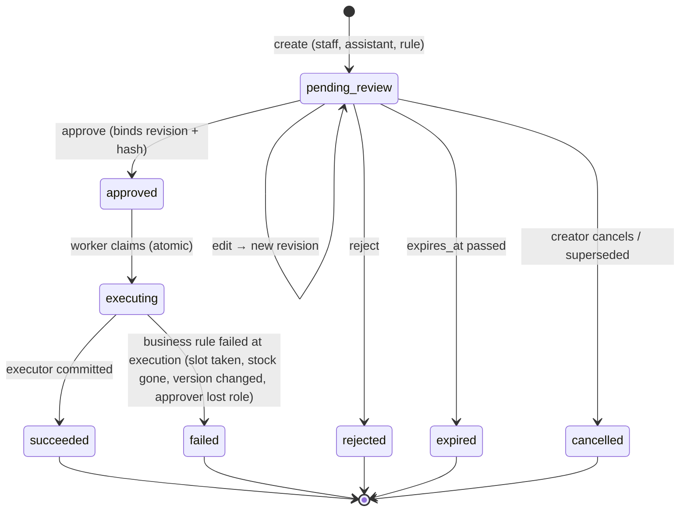

# 07 · Workflow engine: proposals, approvals, execution, jobs, events, outbox, audit

This is the heart of the product and the part with the least room for error. Tasks touching it are **Tier A** (strong model plus human review, [12](12-agent-playbook.md#model-tiers)).

## Two ways to change data

| Path | Who | How | Used for |
|---|---|---|---|
| **Direct** | Authorised staff in the UI | Endpoint → service → audit, in one transaction | Normal ERP work: editing a customer, booking by phone |
| **Proposal** | The AI assistant; staff lacking a permission; rules (e.g. reorder); any action type a business marks "always review" | Proposal → human or delegated policy decision → executor → **the same service functions** | Everything the AI wants to change; sensitive actions |

## Proposals

### Tables (owned by M08 approvals)

```
action_proposals(id, business_id, action_type, status, current_revision_id, origin_kind, origin_user_id,
                 ai_run_id, conversation_id, title, expires_at, version, created_at, updated_at)
proposal_revisions(id, business_id, proposal_id, revision_no, payload jsonb, payload_hash, summary,
                   evidence jsonb, preview jsonb, created_by_kind, created_by, created_at)         -- immutable
approval_decisions(id, business_id, proposal_id, revision_id, decision, decided_by, roles_at_decision,
                   policy_version, payload_hash, comment, decided_at)                              -- immutable
execution_attempts(id, business_id, proposal_id, revision_id, idempotency_key unique, status,
                   acting_user_id, started_at, finished_at, result jsonb, error_code, error_detail)
```

### States



External delivery (for example the reply to the customer) is **not** a proposal state. It is tracked per outbox message (`pending → sending → delivered | failed | unknown; pending → cancelled`). The UI shows "Booked ✓ · Message: delivered / pending / **uncertain — check**". This is how the "needs reconciliation" requirement from the design review is met without blocking the local result.

### Payload, hash and preview

- `payload` is the executor's Pydantic payload model serialised to JSON. It **must include the `version` of every existing record it changes** (for example `customer_version: 3`), so stale proposals fail cleanly.
- `payload_hash = sha256(canonical_json(payload))`. Canonical JSON means sorted keys, no whitespace, UTF-8, decimals as strings and timestamps in UTC `Z` form. It is implemented once in `platform/canonical.py`.
- `preview` is produced by the executor's `describe()` at creation time: a list of human-readable changes (`{"label": "Appointment", "before": null, "after": "Tue 10 Nov, 10:00–11:00 America/Denver · Brake service · Jordan (technician)"}`). The UI shows `preview`, never the raw payload.
- `evidence` is a list of `{kind: "message" | "tool_result" | "record", ref_type, ref_id, excerpt (≤ 500 chars)}`. It shows staff *why* the assistant proposed this.

### Creating a proposal (`approvals.public.create_proposal`)

1. Look up the executor spec for `action_type` in the platform registry. If unknown, raise `approvals.unknown_action_type`.
2. Validate the payload with the spec's `payload_model`. If invalid, raise `422`. For assistant proposals the error goes back to the model as a tool error.
3. Call `spec.validate(db, ctx, payload)`. This is a cheap pre-check (records exist, versions current, slot free). It catches nonsense early but is **not** relied on.
4. Insert the proposal and revision 1, write an audit event and publish `approvals.proposal_created` (for notifications and the dashboard).
5. Default `expires_at` is 24 h, overridable per action type (`scheduling.book_appointment`: 24 h; the hold itself is shorter, see below).

### Deciding (`POST /api/v1/approvals/proposals/{id}/decisions`)

Body: `{"decision": "approve" | "reject", "revision_id": "...", "payload_hash": "...", "comment": "..."}`

In one transaction:
1. `SELECT … FOR UPDATE` the proposal. It must be `pending_review` and not expired.
2. `revision_id` must equal `current_revision_id`, and `payload_hash` must equal that revision's hash. If not, return `409 approvals.revision_changed`, so the UI reloads.
3. The decider must hold `APPROVER_PERMISSION[action_type]` now. The self-approval rule applies ([06](06-security-and-privacy.md#permission-matrix)).
4. Insert `approval_decisions`, set the status, write audit. On approve, enqueue job `approvals.execute` with `dedupe_key = "exec:{proposal_id}:{revision_id}"`.
5. Publish `approvals.proposal_closed` on reject. On approve it is published after execution.

### Executing (job `approvals.execute`)

```text
TX-1 (claim):
  UPDATE action_proposals SET status='executing', version=version+1
   WHERE id=:id AND status='approved' RETURNING *            -- 0 rows → someone else has it → exit OK
  INSERT execution_attempts(idempotency_key = proposal_id||':'||revision_id, status='running', …)
     ON CONFLICT (idempotency_key) DO NOTHING                 -- conflict → resume path below
  COMMIT

TX-2 (do the work), with ctx = the approving user's identity, permissions re-resolved NOW:
  if approver no longer has the approve permission → raise ApproverNotAuthorized
  payload = load revision; assert sha256(canonical(payload)) == stored hash
  result = spec.run(db, ctx, payload, meta)                   -- calls module services; they re-check everything
  UPDATE execution_attempts SET status='succeeded', result=…
  UPDATE action_proposals SET status='succeeded'
  audit.record(... proposal_id ...); events.publish('approvals.proposal_closed', outcome='succeeded')
  COMMIT                                                      -- local changes + outbox rows + audit are atomic

On a business error in TX-2 (Conflict, NotFound, InsufficientStock, ApproverNotAuthorized …):
  ROLLBACK TX-2
  TX-3: attempt.status='failed', error_code=…; proposal.status='failed'; audit; publish proposal_closed(failed)

On a crash or unexpected exception in TX-2:
  TX-2 was rolled back by the database, so nothing happened. The job is retried. Resume path:
  attempt exists with status 'running' and proposal 'executing' → run TX-2 again.
```

Because the local mutations, the outbox rows and "attempt succeeded" commit together, **local effects happen exactly once**. External effects are queued exactly once, and their delivery is at-least-once with idempotency keys passed to the provider.

### Executor interface (`platform/registry.py`)

```python
@dataclass(frozen=True)
class ExecutorSpec:
    action_type: str                      # 'scheduling.book_appointment'
    payload_model: type[BaseModel]
    approve_permission: str               # 'scheduling.proposal.approve'
    describe: Callable[[Session, Context, BaseModel], list[PreviewLine]]
    validate: Callable[[Session, Context, BaseModel], None]          # raises domain errors
    run: Callable[[Session, Context, BaseModel, ExecutionMeta], dict[str, Any]]  # returns result refs
```

### MVP action types

| Action type | Owner module | Effect | Approver permission |
|---|---|---|---|
| `crm.create_customer` | crm | Create customer + contact points | `crm.proposal.approve` |
| `crm.update_customer` | crm | Patch fields (versioned) | `crm.proposal.approve` |
| `scheduling.book_appointment` | scheduling | Confirm hold or create appointment; reserve parts through inventory; optional reply through conversations/notifications | `scheduling.proposal.approve` |
| `scheduling.reschedule_appointment` | scheduling | Move appointment (versioned), move reservations | `scheduling.proposal.approve` |
| `scheduling.cancel_appointment` | scheduling | Cancel, release reservations (no stock movement) | `scheduling.proposal.approve` |
| `conversations.send_reply` | conversations | Add outbound message + outbox delivery | `conversations.proposal.approve` |
| `inventory.adjust_stock` | inventory | Stock movement with reason | `inventory.proposal.approve` |
| `inventory.create_reorder_draft` | inventory (P3) / purchasing (v1) | Draft purchase list (MVP) / draft PO (v1) | `inventory.proposal.approve` |
| `marketing.approve_campaign` | marketing | Freeze audience snapshot + content revision; simulated send | `marketing.proposal.approve` |

### Holds (scheduling and proposals working together)

- When the assistant proposes `scheduling.book_appointment`, its tool first calls `scheduling.public.place_hold(...)`. This creates an `appointments` row with `status='held'` and `hold_expires_at = now() + 30 min` (business setting `hold_minutes`). The no-overlap constraint therefore protects the slot during review.
- A hold is a reversible internal reservation. It is audited (actor `assistant`) and allowed without approval. It never notifies anyone.
- At execution, the executor confirms the hold if it still exists. If the hold has expired, it tries to book the same slot fresh, and if the slot is taken the proposal **fails** with `scheduling.slot_unavailable`. The assistant can then propose a new slot.
- A job releases expired holds every minute. When a proposal closes without success, scheduling (subscribed to `approvals.proposal_closed`) releases its holds immediately.

## Jobs

- Table and fields: [05](05-data-model.md#platform-owned-tables-m00).
- API: `jobs.enqueue(db, kind, payload, business_id=None, run_at=None, priority=100, dedupe_key=None)`, called **inside** the business transaction.
- **Claim** (the worker polls every 500 ms when idle and runs up to `WORKER_CONCURRENCY` threads, default 4):

```sql
update jobs set status='running', locked_by=:worker, locked_until=now() + interval '5 minutes',
                attempts = attempts + 1, updated_at = now()
 where id = (select id from jobs where status='queued' and run_at <= now()
              order by priority, run_at for update skip locked limit 1)
returning *;
```

- **Run:** `Registry.add_job(kind, handler, *, transactional=True)` stores the handler and transaction policy.
  By default, open `transaction(ctx)` with the job's `business_id` and actor `system`, call
  `handler(db, ctx, payload)` and mark the job `succeeded` in the same transaction. With `transactional=False`, call
  `handler(ctx, payload)` with no open worker transaction, then record success in a separate short transaction.
  The handler owns any database transactions it needs; external effects and success recording cannot be atomic,
  so it must tolerate a retry after an effect commits but before success is recorded.
  Non-transactional success and failure updates require the claimed job id, attempt count, `locked_by`, and status
  `running`. Once a reaper or another claim replaces those values, a late result is ignored rather than completing
  a newer attempt or resurrecting a dead job. Handlers must finish within the five-minute lease or be idempotent,
  because a replacement may run concurrently with a handler that exceeded its lease; leases are not renewed.
- **Failure:** in a new transaction, `status='queued'`, `run_at = now() + min(5s·2^attempts, 1h) ± 20 % jitter` and `last_error`. When `attempts >= max_attempts`, set `dead` and raise an in-app alert for admins.
- **Reaper** (every minute): `running` jobs with `locked_until < now()` go back to `queued`.
- **Shutdown:** on SIGTERM or SIGINT the worker stops claiming, lets the jobs and event deliveries it is running finish and
  exits, waiting at most 30 s per thread. A job still running then is abandoned: it stays `running` until its lease expires and
  the reaper requeues it. The dev stack relies on this, because `watchfiles` restarts the worker with SIGINT when Python files change.
- **Handlers must be idempotent** (a job may run twice after a crash).
- **Scheduled jobs:** modules register `Registry.add_cron(name, job_kind, every_seconds, *, per_business=False)`.
  Each global job uses `dedupe_key="cron:{name}:{slot}"`, so several workers never duplicate it. With
  `per_business=True`, each slot enqueues one job per active business, sets `business_id`, and uses
  `dedupe_key="cron:{name}:{slot}:{business_id}"`. Discovery uses `public.active_business_ids()`, a SECURITY DEFINER
  function selecting only `status='active'`, with `search_path = pg_catalog, public, pg_temp`, PUBLIC execution
  revoked, and execution granted to `smb_app`. Existing crons remain global by default.

## Domain events

- `events.publish(db, ctx, type, payload_model)` inserts one `domain_events` row plus one `event_deliveries` row **per registered subscriber**, in the caller's transaction. Nothing is published if the business transaction rolls back.
- Event types are Pydantic models defined in the publishing module's `events.py` and exported via `public.py`. The type name is `<module>.<past_tense>`, and payloads carry IDs and small facts, never full records.
- The worker claims deliveries the same way as jobs and calls the subscriber in a business transaction. Delivery is at least once, so **subscribers must be idempotent**, for example by using `dedupe_key = event_id`.
- **A module may subscribe only to events of modules it is allowed to depend on** (same graph as imports). The dashboard reads live data and subscribes to nothing.
- MVP event catalog:

| Event | Published by | Subscribers |
|---|---|---|
| `conversations.message_received` | conversations | ai (intake) |
| `conversations.handoff_requested` | conversations | ai (stops intake for that thread). Staff are notified by conversations calling `notifications.notify_users` directly (call downward) |
| `approvals.proposal_created` | approvals | notifications (in-app to approvers) |
| `approvals.proposal_closed` | approvals | scheduling (release holds), ai (learning stats), notifications |
| `scheduling.appointment_confirmed` / `_cancelled` / `_rescheduled` | scheduling | ai (briefing cache invalidation) |
| `inventory.stock_below_reorder_level` | inventory | ai (reorder note). The Today page shows low stock by reading inventory directly |
| `crm.customer_created` / `_merged` | crm | marketing (refresh segments), ai |

## Outbox (M10 notifications)

- `notifications.public.enqueue_message(db, ctx, channel, recipient, template_key, variables, idempotency_key, related)` inserts into `outbox_messages` inside the business transaction.
- The worker claims pending messages, renders the template and calls the channel adapter: `simulated` (MVP; always "delivered" and visible in the UI as *Simulated*), `smtp` (v1) or `in_app`.
- Adapter results map to statuses:
  - `delivered` (with a provider message ID)
  - `failed_retryable` (back to pending with backoff)
  - `failed_permanent`
  - `unknown`: a timeout after the request was sent. The message is **not** retried automatically. It shows as "uncertain" with buttons *Mark delivered* and *Retry anyway*, and either choice is audited.
- The idempotency key is passed to providers that support it.

## Audit

- `audit.record(db, ctx, *, action, target_type, target_id, summary, changes=None, proposal_id=None)` lives in `platform/audit.py`. It fills actor, `on_behalf_of_user_id`, `ai_run_id` and `request_id` from `ctx`.
- **Every service function that mutates data calls it exactly once per logical change, in the same transaction.** If the audit insert fails, the whole change rolls back.
- `audit.diff(before, after, redact=…)` produces `{"field": {"from": x, "to": y}}`, with redacted fields shown as `"[redacted]"`.
- The application role has only `INSERT` and `SELECT` on `audit_events`. A v1 task adds a nightly hash chain (`prev_hash`, `hash`) and export to Object Storage. This is tamper-*evident*, not tamper-proof; a database superuser can still alter data, and the docs say so.

P10-A0 adds delegated autonomy decisions for AI reorder drafts, with no change to the claim/resume algorithm.
The detailed schema and API extension is [Autonomy rules (P10-A0)](ai/contracts.md#autonomy-rules-p10-a0).

P10-A1 extends the executor contract with `second_person` (boolean or payload callback) and optional
`chat_money` exposure. Chat confirmation, typed human decision provenance, PO delivery, delay/stop and
operational read APIs are specified in [the A1 contract](ai/contracts.md#p10-a1-confirm-in-chat-po-delivery-send-delay).
The outbox claim enforces not_before and retry time while holding the row lock; Stop competes with it.
